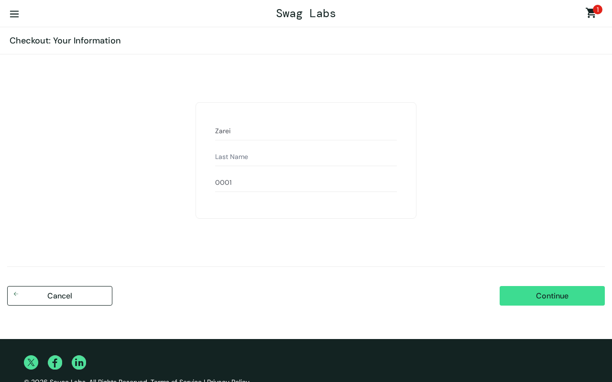

# Last name typed into the checkout form ends up in the First Name field

**Environment:** saucedemo.com, Chromium 158, desktop 1280×800
**Account:** `problem_user`
**Severity:** High — the order ships with the wrong name on it
**Reproduced:** 3 out of 3 attempts

## Steps

1. Log in as `problem_user`.
2. Add any product to the cart.
3. Open the cart and press **Checkout**.
4. Click the **First Name** field and type `Ahmad`.
5. Click the **Last Name** field and type `Zarei`.
6. Click the **Zip/Postal Code** field and type `0001`.
7. Look at all three fields without clicking anywhere else.

## Expected

First Name `Ahmad`, Last Name `Zarei`, Postal Code `0001`.

## Actual

First Name reads `Zarei`. Last Name is empty. Postal Code is `0001`.

The character that goes into the Last Name field is written into the First Name field
instead, replacing what was already there. The Last Name field never receives focus in a
way that lets it hold a value.

## Why it's easy to miss

If you fill the form by tabbing through it and press Continue without looking back, the
form looks complete to the eye — three boxes, all with text in them — and nothing errors
out. The confirmation page then shows the order under the wrong name. You only catch it if
you read the fields after typing, or if you compare against `standard_user` where the same
steps behave correctly.

## Contrast

Same steps on `standard_user` give `Ahmad` / `Zarei` / `0001`. That rules out my typing
and points at something specific to how this account's form is set up.
