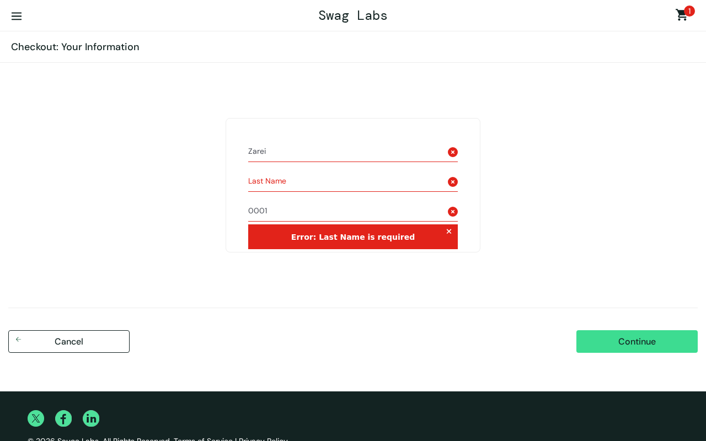

# Last name typed into the checkout form ends up in the First Name field

**Environment:** saucedemo.com, Chromium 158, desktop 1280×800
**Account:** `problem_user`
**Severity:** Blocker. This account cannot place an order at all
**Reproduced:** 3 out of 3 attempts

## Steps

1. Log in as `problem_user`.
2. Add any product to the cart.
3. Open the cart and press **Checkout**.
4. Click the **First Name** field and type `Ahmad`.
5. Click the **Last Name** field and type `Zarei`.
6. Click the **Zip/Postal Code** field and type `0001`.
7. Press **Continue**.

## Expected

First Name `Ahmad`, Last Name `Zarei`, Postal Code `0001`, and the order summary step.

## Actual

First Name reads `Zarei`. Last Name is empty. Postal Code is `0001`.

The characters meant for the Last Name field are written into the First Name field instead,
replacing what was already there. The Last Name field never takes a value.

Then **Continue refuses to move on**, with `Error: Last Name is required`, pointing at a field
the user cannot fill. There is no way past this screen: retyping the last name puts it in the
first-name box again.

## Why the severity is Blocker, not High

The field mismatch alone would be High, because an order would ship with the wrong name on it.
What makes it a blocker is the follow-on: the validation is correct, the field is empty, and it
cannot be filled. So this account cannot complete a purchase at all. A customer in this state
abandons the basket.

## Why it's easy to miss

If you fill the form by tabbing through and press Continue without looking back, the form looks
complete to the eye: three boxes, all with text in them. Nothing errors out at the moment of
typing. You only catch it if you read the fields after filling them, or if you compare against
`standard_user` where the same steps behave correctly.

## Contrast

Same steps on `standard_user` give `Ahmad` / `Zarei` / `0001` and move on to the summary. That
rules out my typing and points at something specific to how this account's form is set up.
