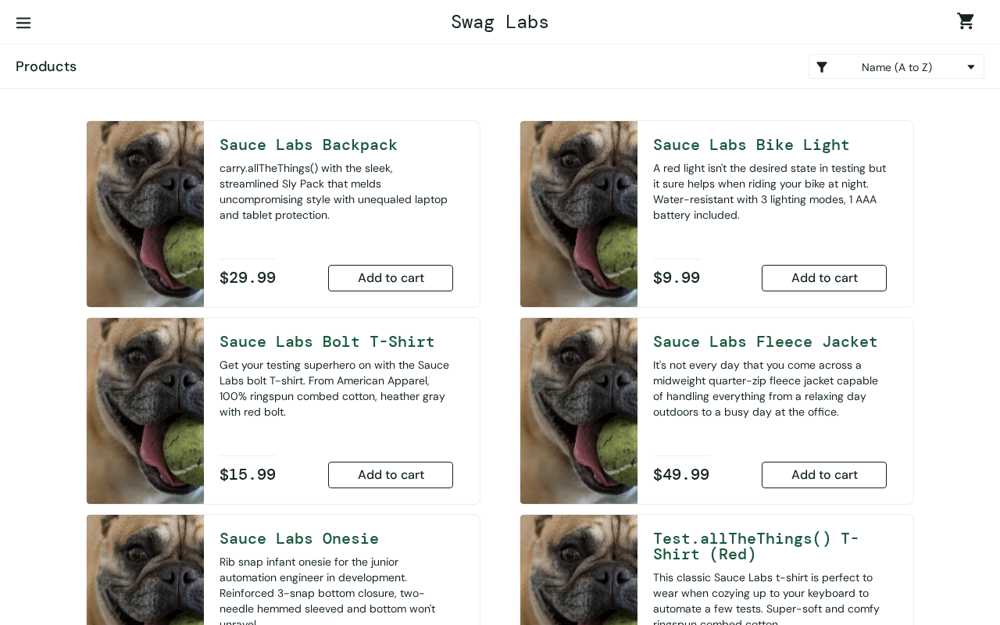

# All six product images are the same broken-image file

**Environment:** saucedemo.com, Chromium 158, desktop 1280×800
**Account:** `problem_user`
**Severity:** Medium — the page looks broken and you can't tell products apart
**Reproduced:** 3 out of 3 attempts

## Steps

1. Log in as `problem_user`.
2. Look at the product list on the inventory page.
3. Right-click any product image and open it in a new tab.

## Expected

Six different product photos. A backpack looks like a backpack.

## Actual

All six `` elements point at `/assets/sl-404-Cq1a9k9X.jpg`, the site's own 404
placeholder image. Every card shows the same grey "image not found" art. The filename
alone tells you the request was never going to succeed.

I checked this by reading the `src` attribute of each image and its `naturalWidth`:

```
problem_user : 6 × /assets/sl-404-Cq1a9k9X.jpg (600px)
standard_user: 6 different files — sauce-backpack, bike-light, bolt-shirt, ...
```



## Why it's easy to miss

The page doesn't throw an error and nothing in the console says "image failed" in a way you
notice. The layout stays intact, prices are right, and Add to Cart works. If you're testing
by reading what's rendered rather than checking the network tab, "the images look a bit
generic" doesn't immediately read as a defect.

## Note

The same asset is 600px wide here. On `standard_user` five images come back at 640px and the
Bike Light at 320px, so the placeholder isn't even the same size as what it replaces.
