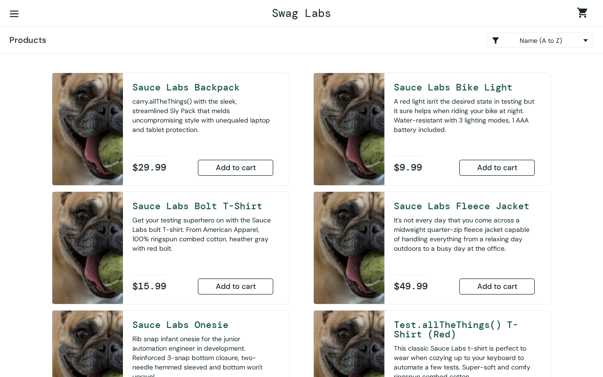
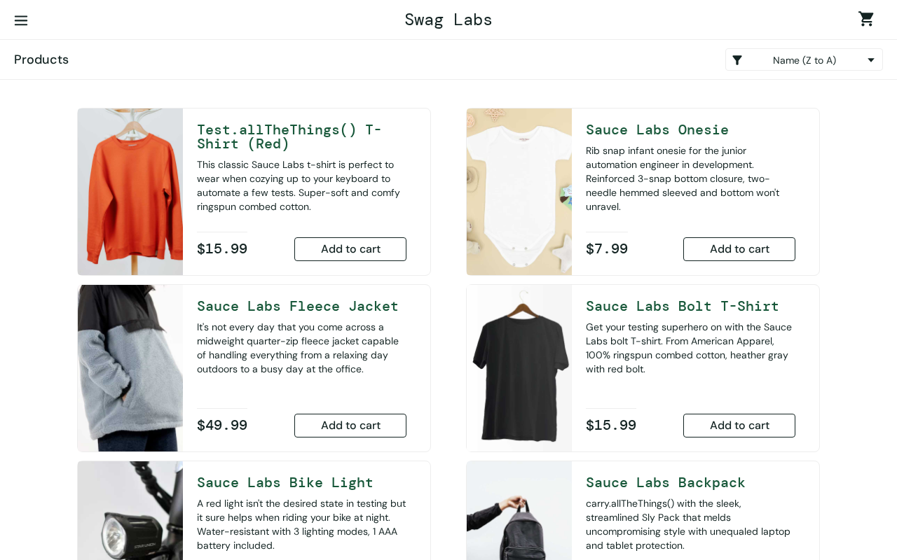

# Sorting is broken for every option, and the dropdown snaps back to A-Z

**Environment:** saucedemo.com, Chromium 158, desktop 1280×800
**Account:** `problem_user` and `error_user`
**Severity:** Medium. The control looks like it worked, so nobody retries it
**Reproduced:** 5 out of 5 attempts on both accounts, all four options

## Steps

1. Log in as `problem_user` (or `error_user`).
2. On the inventory page, open the sort dropdown and choose **Name (Z to A)**.
3. Look at the dropdown itself, then at the list.

## Expected

The dropdown keeps `za`, and the list reorders with `Test.allTheThings() T-Shirt (Red)` at the top.
That is what `standard_user` gets with the same selection.

## Actual

Two things go wrong at once:

1. **The dropdown reverts to `az`.** The choice does not stick. Whatever you pick, the
   control reads `Name (A to Z)` again a moment later.
2. **The list never reorders.** It stays in the original catalogue order.

It happens on all four options, not just the price ones:

| Option chosen | Dropdown then shows | First product | Same as standard_user? |
|---|---|---|---|
| Name (A to Z) | `az` | Sauce Labs Backpack | yes, but this is the default anyway |
| Name (Z to A) | `az` | Sauce Labs Backpack | **no** |
| Price (low to high) | `az` | Sauce Labs Backpack | **no** |
| Price (high to low) | `az` | Sauce Labs Backpack | **no** |

I confirmed the revert by reading the `value` of the select element after a two-second wait,
not by looking at it: after choosing `za`, `document.querySelector('.product_sort_container').value`
returns `az`.

**`standard_user`, same selection, dropdown stays on Z to A and the list reorders**

## Why it's easy to miss

The control gives good feedback at first. You click, the select opens, you pick an option, and
it closes. The list looks like a list, six products with names and prices. If you do not
re-read the dropdown afterwards, and you do not happen to know that `Onesie` should be first
for price-low-to-high, nothing announces itself. Sorting is also the kind of feature nobody
double-checks, because it either works or is obviously broken, and this is neither.

My first pass at this got it half right: I noticed the list was not sorting and wrote it up as
a price-sort defect. Then I checked the select value and found the dropdown was reverting too,
and that name sorting was broken as well. Worth remembering that the visible symptom was one
step away from the actual behaviour.

## How I would narrow it

Compare against `standard_user` first to prove the expectation. Then check the select element's
value before and after the change. If the value reverts, the component is resetting its own
state, which is a different bug from a sort handler that runs and produces no reorder. Both
are worth a look at the inventory component's state handling, but the first one points at the
controlled select rather than at the sorting function.

## What I did not test

Whether the sort works on a hard page refresh, since I only tested the in-page change. Also
whether it fails the same way on a mobile viewport.
