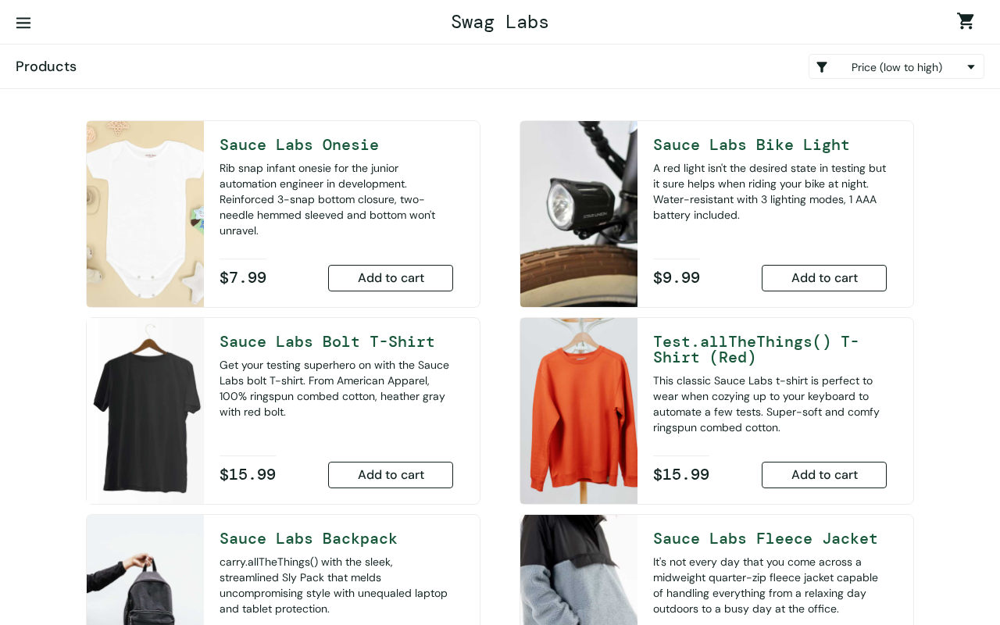

# "Price (low to high)" leaves the list in its original order

**Environment:** saucedemo.com, Chromium 158, desktop 1280×800
**Account:** `problem_user` and `error_user`
**Severity:** Medium — the control looks like it worked
**Reproduced:** 4 out of 4 attempts on both accounts

## Steps

1. Log in as `error_user` (or `problem_user`).
2. On the inventory page, open the sort dropdown and choose **Price (low to high)**.
3. Read the prices from top to bottom.

## Expected

Prices ascend: `$7.99, $9.99, $15.99, $15.99, $29.99, $49.99` — the same result
`standard_user` gets.

## Actual

The list doesn't move: `$29.99, $9.99, $15.99, $49.99, $7.99, $15.99`.

Nothing redraws, no spinner, no error. The dropdown itself changes to show the new
selection, so the interface tells you the choice was accepted. It just never applies.

Name A–Z and Z–A behave correctly on the same accounts, so it's specific to the price sort.

**`error_user`, price low to high — unsorted**

**`standard_user`, same selection — sorted correctly**

## Why it's easy to miss

The control gives good feedback. The select box updates, the list looks like a list, and if
you don't re-read the numbers you assume it sorted. Sorting six items is also something
nobody double-checks, because it's the kind of thing that either works or is obviously
broken — except here it's neither.

## How I'd narrow it

Compare against `standard_user` first to prove the expectation. Then check whether the
sort fires at all — if the network or the state update happens but the DOM doesn't reorder,
that's the component; if nothing fires, the handler isn't bound for these accounts.
