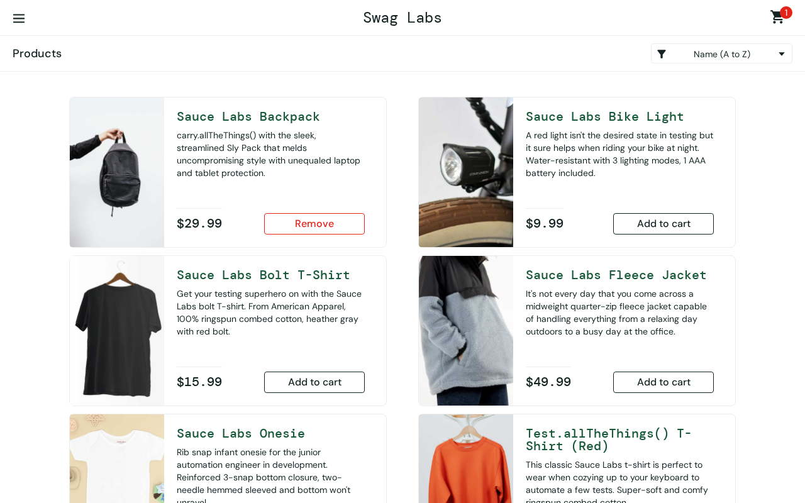

# Remove on the product list does nothing, but works from the cart page

**Environment:** saucedemo.com, Chromium 158, desktop 1280×800
**Account:** `error_user`
**Severity:** High — the item stays in the cart and can't be removed from that screen
**Reproduced:** 3 out of 3 attempts

## Steps

1. Log in as `error_user`.
2. On the inventory page, press **Add to cart** on the first product.
   The button changes to **Remove** and the cart badge shows `1`.
3. Press that **Remove** button.
4. Check the button label and the cart badge.

## Expected

The item leaves the cart: the badge disappears (or drops to `0`) and the button goes back
to **Add to cart**.

## Actual

The badge still reads `1` and the button still reads **Remove**. Nothing happens at all —
no request, no visual change, no error.

## What makes this one interesting

Open the cart page for the same account and press Remove there, and it works: the item goes,
the badge clears, the cart empties. So the cart logic is fine — the button on the inventory
list is the piece that's broken.

That narrows it a lot. Same user, same item, same intent, two entry points, one of them
dead. I'd be looking at whether the inventory card's handler is bound for this account
before touching anything on the cart side.

## Why it's easy to miss

The first click works. Add to cart succeeds, the badge appears, the button flips to
Remove — everything is behaving right up to the moment you try to undo it. A tester who
adds an item and moves on never sees it. You have to try removing from the same screen you
added from, which is the less usual path.

## Workaround

Remove from the cart page instead.
