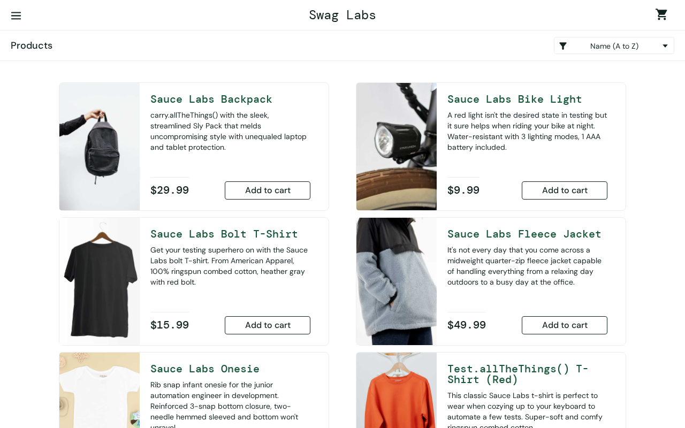
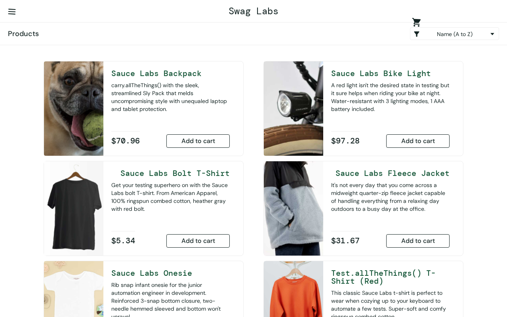

# Prices on the product list don't match the ones other accounts see

**Environment:** saucedemo.com, Chromium 158, desktop 1280×800
**Account:** `visual_user`, compared against `standard_user`
**Severity:** High — the number the customer sees is not the catalogue price
**Reproduced:** 3 out of 3 attempts

## Steps

1. Log in as `standard_user` and note the six product prices.
2. Log out, log in as `visual_user`.
3. Compare the same six products, same names, same order.

## Expected

The same price for the same product. A price is catalogue data, not something that should
follow the account you're signed in as.

## Actual

Every price is different, and it changes again between sessions.

| Product | `standard_user` | `visual_user` |
|---|---|---|
| Sauce Labs Backpack | $29.99 | $80.42 |
| Sauce Labs Bike Light | $9.99 | $38.87 |
| Sauce Labs Bolt T-Shirt | $15.99 | $79.36 |
| Sauce Labs Fleece Jacket | $49.99 | $78.44 |
| Sauce Labs Onesie | $7.99 | $68.93 |
| Test.allTheThings() T-Shirt (Red) | $15.99 | $89.47 |

On a second run the `visual_user` column came back as `$69.85, $64.77, $28.84, $64.78,
$42.46, $96.9` — same account, different numbers again.

The Onesie is the one to look at closely: `$7.99` against `$68.93` is nearly nine times
the price for the same item.

**`standard_user`**

**`visual_user`, same product list**

## Why it's easy to miss

Each screen is internally consistent. `visual_user` sees six prices that look like prices,
formatted the same way, with the decimal places in the right spot. Nothing flags as wrong
until you put two accounts side by side, which most testers never do because they work
through one account at a time.

I only caught it because I'd already screenshot the `standard_user` list while working on
the sort bug and the numbers didn't look familiar when I scrolled back.

## What I'd want to know next

Is the wrong price sent to the server at checkout, or corrected there? That decides whether
this is a display defect or a billing one, and it changes the severity completely. I didn't
take it that far because the demo checkout doesn't charge anything, so I couldn't verify what
actually gets charged.
